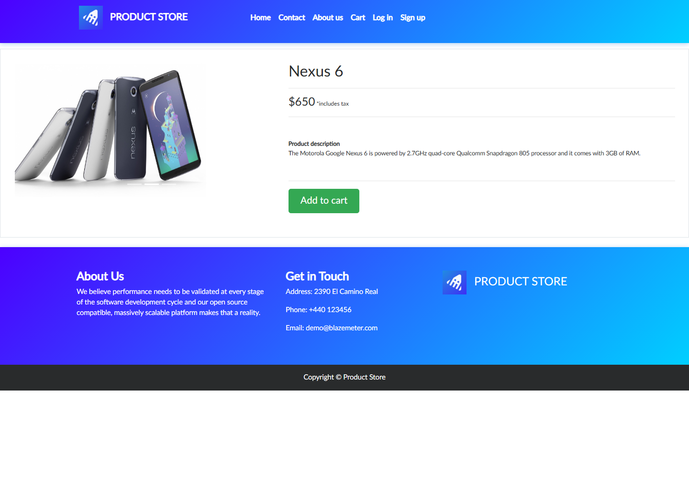
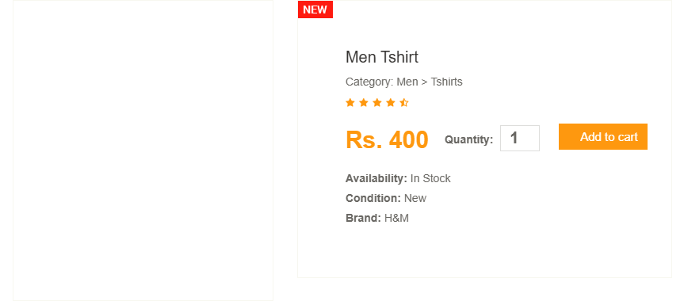
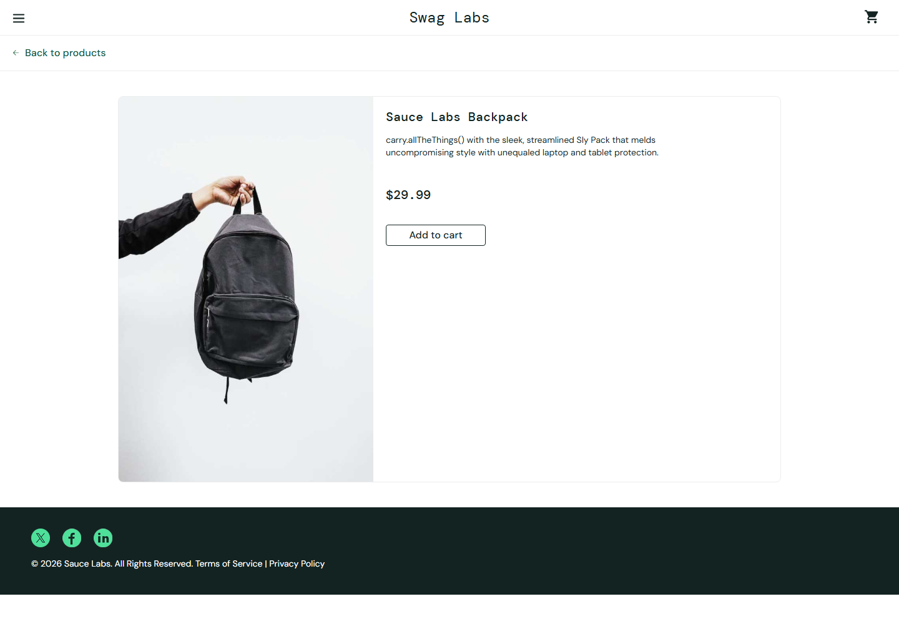

# Web2API — prueba de flujos en otras webs

17 de octubre de 2026 · ejecución HTTP después de cerrar el navegador.

**Resultado:** dos workflows de lectura compilados y reproducidos en sitios
externos; un tercer recorrido rechazado por falta de una API observada. Se
contrastaron los resultados con UI y el agente inspeccionó las capturas.
No se probaron compras, carrito, reservas ni pagos externos.

| Sitio | Tarea de usuario evaluada | Resultado |
|---|---|---|
| Demoblaze | Entrar a Phones, elegir un teléfono y obtener su ficha correcta | 3/3 escenarios; Nexus 6 no fue usado para compilar |
| Automation Exercise | Buscar ropa y comprobar la ficha de un resultado | 4/4 escenarios; `tshirt` no fue usado para compilar |
| SauceDemo | Login demo, catálogo y ficha | UI completada; sin API observada, herramienta rechazada |

Los cocientes describen estas muestras, no una tasa de éxito de internet.

## Demoblaze: una dependencia entre pasos

1. Categoría Phones: la pantalla lista teléfonos; una petición JSON obtiene el catálogo.
2. Selección: el nombre permite identificar un registro y extraer su ID.
3. Ficha: otra petición usa ese ID. Se contrastan identidad, nombre, categoría,
   descripción y precio con el catálogo. No basta con recibir HTTP 200.

El compilador recibió dos demostraciones: Samsung galaxy s6 (`$360`) y Nokia
lumia 1520 (`$820`). Generó por inferencia un binding desde `Items[*].title` al
parámetro `id` de la siguiente petición, sin fijar los IDs 1/2 en el runtime.
La prueba reservada consultó Nexus 6, obtuvo ID 3 y `$650`, y coincidió con su
ficha visible. Un teléfono inexistente detuvo el flujo antes de inventar una ficha.
El símbolo `$` no se convierte automáticamente en una moneda ISO.



## Automation Exercise: no asumir que buscar significa filtrar solo el nombre

1. Buscar en la UI: se observaron resultados para `top`, `dress` y `blue`.
2. Abrir la ficha: se comprobaron nombre, categoría, marca y precio del primer resultado.
3. Repetir por las APIs documentadas: catálogo completo → búsqueda por formulario.
4. Contrastar todos los IDs, nombres y precios con catálogo y lista de resultados UI.

Buscar `dress` también devuelve “Sleeves Top and Short - Blue & Pink”: su
categoría es Dress. Por eso una regla ingenua `nombre contiene query` rechaza
resultados válidos. Las tres demostraciones permiten inferir una comprobación
`nombre O category.category contiene query`; no es una declaración exhaustiva
de todas las reglas internas del sitio.

La prueba reservada `tshirt` devolvió seis productos y coincidió con la lista UI.
La ficha de Men Tshirt mostró `Rs. 400`, como la API. También se probó una búsqueda
sin resultados. El precio se conserva como texto; no se deduce una moneda ISO.

La UI no hizo las llamadas JSON de estas APIs: se localizaron en la
[documentación del propio sitio](https://automationexercise.com/api_list).
El reporte distingue ese origen de las peticiones observadas en Demoblaze.
El servidor etiqueta sus respuestas JSON como `text/html`; solo las dos rutas
revisadas admiten esa excepción, y su cuerpo debe seguir siendo JSON válido.



En estas capturas de Automation Exercise algunas imágenes no cargaron. La
confirmación visual acredita los textos y precios visibles, no esas imágenes.

## SauceDemo: un rechazo útil

Se recorrió login de demostración → catálogo → Sauce Labs Backpack (`$29.99`).
El sitio fue utilizable en pantalla; no se observaron peticiones fetch/XHR de
datos de primera parte para ese recorrido. El compilador devuelve
`API_PATH_NOT_OBSERVED` y no publica una herramienta para él.

Eso no prueba que sea imposible encontrar otra API del sitio. Prueba que este
descubrimiento no obtuvo una ruta API suficiente y no la sustituyó por clics.



## Qué entiende ya el motor y qué sigue dependiendo del agente

El mismo compilador ahora infiere parámetros, dependencias entre respuestas y
requests, esquemas, joins de identidad/atributos y algunas comprobaciones de
filtrado. Los casos reservados impiden aprobar solo una grabación con IDs fijos.
El runner ejecuta y comprueba la secuencia por HTTP; no consulta al modelo.

El agente todavía elige el objetivo, identifica controles UI, realiza las
demostraciones y revisa qué endpoints son lecturas autorizadas. La intención de
negocio no se descubre autónomamente desde una URL. Los invariantes inferidos
pueden ser incompletos y requieren ejemplos discriminantes y revisión. Esta
versión demuestra **inferencia y replay de flujos de lectura guiados**, no
comprensión general autónoma de una web o de una compra completa.

## Reproducción y artefactos

```powershell
npm run discover:multisite
npm run test:multisite
npm test
npm run build
npm run test:package
```

Requiere Node 24, `npm ci --ignore-scripts` y Chromium instalado mediante
`npx playwright install chromium`. La inspección visual debe repetirse después
de regenerar capturas; no queda acreditada automáticamente por esos comandos.

- Recetas: `recipes/demoblaze.json` y `recipes/automationexercise.json`.
- Evidencia: `evidence/multisite-validation.json` y `evidence/multisite-visual-review.json`.
- Capturas completas y trazas saneadas: `artifacts/multisite/` y `.local/multisite/`.
- Diez tests cubren dependencias, casos no vistos, inventario inconsistente,
  falsos éxitos, ambigüedad, entradas rechazadas y red sin fallback.
- El smoke conecta al paquete copiado fuera del repositorio, comprueba sus tres
  herramientas tipadas, llama a los tres sitios y verifica REST con/sin autenticación.

El plugin se actualiza a 0.2.0 conservando identidad y sin cambiar Web2API Forge.
