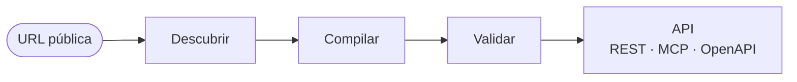

<div align="center">

# Web2API

**Convierte una web en una API tipada y validada.**

[Demo](#demo) · [API](#api) · [Estructura](#estructura) · [Límites](#límites) · [Documentación](#documentación)


</div>

---

Web2API recibe una URL pública, observa sus operaciones de lectura y las
convierte en workflows declarativos con parámetros, dependencias y
comprobaciones. Después los valida contra casos que no vio y los publica como
una API propia: REST, MCP y OpenAPI.

El resultado se invoca como cualquier API. Cada workflow es un JSON con datos,
no código; el motor solo ejecuta operaciones revisadas y verifica la respuesta
antes de entregarla.

```text
https://sitio.com/productos
        │
        ▼
GET  /v1/catalog
POST /v1/workflows/buscar_producto   { "query": "laptop" } → resultados
```

## Cómo funciona



1. **Descubrir** — un worker aislado abre la web y registra el tráfico JSON y
   las operaciones de lectura observadas.
2. **Compilar** — `src/read-workflow.mjs` infiere parámetros, IDs dependientes,
   esquemas y reglas de búsqueda a partir de demostraciones, no de rutas
   hardcodeadas por sitio.
3. **Validar** — un caso reservado se ejecuta por HTTP y se contrasta con la
   evidencia. Si falla, el workflow no se publica.
4. **Servir** — el catálogo queda disponible por REST, MCP y la interfaz web.

En ejecución no hay navegador, visión ni llamadas a un modelo: solo HTTP.

## Demo

Requiere Node 24.x.

```bash
npm ci --ignore-scripts
npm start
```

Abre `http://127.0.0.1:4319`.

Para presentar sin Internet:

```bash
npm run studio:demo
```

Abre `http://127.0.0.1:4320` con tres productos ficticios, precios PEN y un
carrito temporal. El arranque observa la API local y compila su receta; cada
ejecución posterior hace HTTP real. Una escritura requiere confirmación y se
comprueba releyendo el carrito. No hay pagos ni datos reales.

## API

| Método | Ruta | Descripción |
| --- | --- | --- |
| `GET` | `/v1/catalog` | Workflows disponibles y su esquema de entrada. |
| `POST` | `/v1/workflows/{workflow_id}` | Ejecuta un workflow con `{ "arguments": … }`. |

El consumidor externo envía `Authorization: Bearer <WEB2API_API_KEY>`; la UI
local crea su propia sesión HttpOnly. El servidor escucha solo en loopback y el
contrato completo está en [`openapi.json`](openapi.json).

Los errores usan códigos estables (`INVALID_INPUT`, `UPSTREAM_CHANGED`,
`REAUTH_REQUIRED`, `VERIFICATION_FAILED`, …) y no exponen detalles del upstream
ni secretos.

## Estructura

```text
src/        motor: catálogo, compilador, contratos, red y adaptadores
web/        Workflow Studio
scripts/    build, demos y validaciones
test/       contratos sintéticos y pruebas del motor
recipes/    workflows compilados, sin código ni credenciales
evidence/   informes fechados que el catálogo verifica al arrancar
```

`plugin.json`, `mcp.json` y `skills/` permiten consumir el catálogo desde MCP y
Codex.

## Límites

- El descubrimiento es **asistido y acotado**: trabaja sobre una URL HTTPS
  pública y exige revisar las operaciones antes de compilar. No es un
  descubridor universal autónomo.
- No se resuelven CAPTCHA, no se rotan proxies y no se evaden controles de
  acceso.
- Las escrituras requieren confirmación explícita. El laboratorio es de un solo
  actor y no acredita concurrencia.
- UVCV (Moodle) y WhatsApp son integraciones de **solo lectura**. WhatsApp usa
  un cliente no oficial y puede infringir sus términos.
- La API de USGAR no se ha identificado como contrato público estable: si
  cambia, el workflow falla y pide revisión, no reparación automática.

## Documentación

| Documento | Contenido |
| --- | --- |
| [AUTHENTICATION.md](AUTHENTICATION.md) | Sesiones autenticadas y manejo de cookies. |
| [SDD.md](SDD.md) | Alcance implementado y criterios de la siguiente fase. |
| [MULTISITE_REPORT.md](MULTISITE_REPORT.md) | Validación en sitios reales, con capturas. |
| [SOCIAL_REPORT.md](SOCIAL_REPORT.md) | Recorridos sobre X y WhatsApp. |

## Calidad

```bash
npm test          # contratos y motor
npm run test:studio   # interfaz con Chromium
npm run build     # paquete autocontenido + openapi.json
npm run check     # sintaxis, manifiestos y runtime sin navegador
```

`build` genera el paquete autocontenido en `artifacts/web2api-app`.
