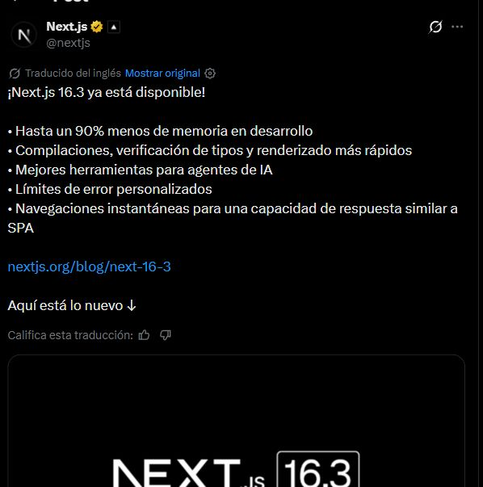
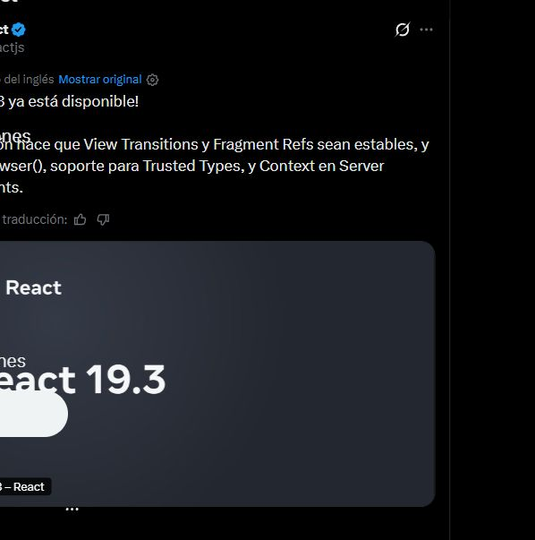

# Web2API — WhatsApp y X

17 de octubre de 2026. Prueba de lectura con las sesiones existentes del navegador.
No se enviaron mensajes, publicaron posts, dieron likes, siguieron cuentas ni
modificaron permisos. No se vincularon dispositivos nuevos.

| Sitio | Recorrido | Resultado |
|---|---|---|
| X | Perfil → ID de usuario → publicaciones → detalle | Dos perfiles públicos, seis lecturas HTTP con identidades comprobadas y confirmación visual |
| WhatsApp | Búsqueda vacía → buscar chat propio → abrirlo | UI confirmada; transporte/API no verificados |

## X: API demostrada dentro de una sesión

Se capturaron `UserByScreenName`, `UserOriginalsTimeline` y `TweetDetail`.
El nombre devuelve un ID de usuario; la cronología usa ese ID; el detalle usa
un ID de publicación devuelto por la cronología. Se comprobó autor e identidad
final, no solamente HTTP 200.

| Perfil público | ID de usuario | Publicación comprobada |
|---|---|---|
| nextjs | 1467726470533754880 | 2084399799642841419 |
| reactjs | 1566463268 | 2097766969080680729 |

Los dos recorridos se repitieron mediante `fetch` de mismo origen, sin clics,
DOM ni visión durante las llamadas. Las seis consultas devolvieron 200 y se
contrastaron sus IDs y autores con la pantalla.

La autenticación permaneció dentro del navegador. No se exportaron cookies,
tokens o cabeceras al repositorio; se liberaron los buffers temporales. La
captura de eventos fue parcial/truncada y no representa todo el tráfico.

**Esto acredita replay API con sesión del navegador. No acredita un servicio
Node independiente sin navegador ni estabilidad tras expirar esa sesión.**
El agente reconstruyó el recorrido: el compilador no descubrió autónomamente
las reglas GraphQL ni administra su autenticación.

La [API oficial de X](https://docs.x.com/fundamentals/authentication/overview)
documenta autenticación de aplicación y de usuario. Una sesión web abierta no
equivale a credenciales de desarrollador. No se crearon apps ni se concedieron
permisos nuevos. Esa API es una alternativa pendiente de configurar y probar.

## WhatsApp: UI comprobada, API pendiente

Se confirmó visualmente una búsqueda sin coincidencias y después la cabecera
del chat propio, con el compositor presente. No se guardaron capturas de chats,
contactos ni cuerpos de mensajes.

El diagnóstico CDP de esa pestaña informó que no estaba disponible mientras
resolvía una respuesta de documento pausada. Por tanto, no se capturó ni repitió
el transporte de chats. **Es una limitación de la herramienta; no demuestra que
no exista una API ni que las búsquedas sean siempre locales.**

La [arquitectura publicada por Meta](https://engineering.fb.com/2021/07/14/security/whatsapp-multi-device/)
describe claves por dispositivo, sincronización cifrada y una base local de
historial en el dispositivo vinculado. No debe suponerse un GET de JSON con
mensajes legibles. Esto procede de documentación, no de frames capturados aquí.

Como rutas técnicas se revisaron [Baileys](https://github.com/WhiskeySockets/Baileys),
basado en WebSockets, y [whatsapp-web.js](https://github.com/wwebjs/whatsapp-web.js),
dependiente de la aplicación de navegador. No son APIs oficiales de Meta; no se
instalaron, ejecutaron ni probaron con esta cuenta. La documentación Cloud de
Meta devolvió 429: no se reintentó ni se usó como evidencia de historial personal.

## Consecuencia para Web2API

El compilador ahora rechaza explícitamente trazas con contexto de sesión
(`SESSION_TRANSPORT_REQUIRED`) o transportes ajenos a su JSON/HTTP
(`UNSUPPORTED_TRANSPORT`). Se añadió una prueba de ambos rechazos. Evita perder
esa dependencia al generar una receta pública que aparentaría ser autónoma.

Para X falta un ejecutor HTTP con sesión administrada o un adapter de su API
oficial con autenticación propia. Para WhatsApp falta observar el protocolo o
evaluar un cliente especializado con una vinculación autorizada. No se extrajeron
claves para sustituir ese paso.

En la fecha de este informe no se publicaban herramientas sociales. Desde el
20 de octubre existe el MCP dedicado de WhatsApp descrito al final. Se conservan
las tres herramientas ya verificadas. La versión 0.2.1 incluye estos rechazos y
la evidencia; once tests y el smoke MCP/REST comprueban que no se rompen los
recorridos existentes.

`evidence/social-validation.json` contiene únicamente estados de prueba e IDs
de perfiles/posts públicos. Los ensayos sociales fueron interactivos en esta
sesión; no se presentan como una suite autónoma reproducible sin autenticación.

## Actualización 20 de octubre de 2026: puente Baileys de solo lectura

Se instaló `@whiskeysockets/baileys` **6.7.24** (dist-tag `legacy`, MIT) y se
implementó un cliente multidispositivo de solo lectura. No se capturaron frames
de WhatsApp Web: el puente usa el protocolo de la librería, no una API de Meta.
`npm run whatsapp:login` vincula un dispositivo por QR, espera la sincronización
inicial y guarda credenciales y snapshot locales; `npm run mcp:whatsapp` expone
estado, chats, mensajes y búsqueda de texto. No envía mensajes, presencia ni
confirmaciones de lectura, y no descarga multimedia. Sigue siendo un cliente no
oficial con riesgo de restricción de la cuenta. `npm run whatsapp:validate`
pasó el 20 de octubre de 2026 con 1000 chats y 6480 mensajes en la instantánea,
orden, pertenencia, búsqueda y rechazo de entrada inválida; el informe está en
`evidence/whatsapp-validation.json`, sin nombres, JIDs ni cuerpos de mensajes.
